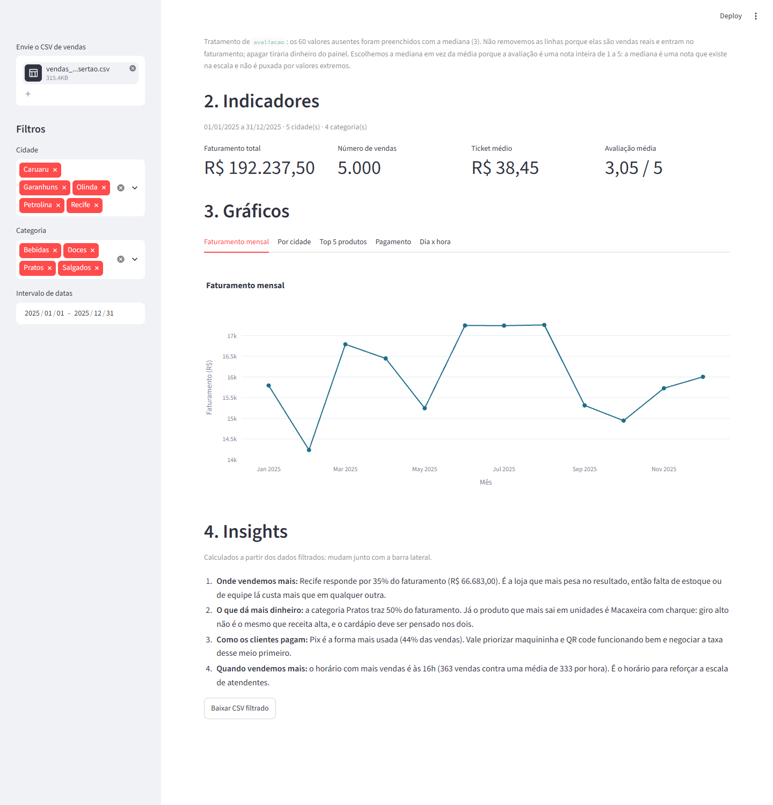

# Painel de Vendas: Sabor do Sertão

Autor: Everson José do Nascimento (TADS047, noite). Atividade feita individualmente.

Painel interativo em Streamlit com um ano de vendas da rede fictícia de lanchonetes
Sabor do Sertão (Recife, Olinda, Caruaru, Petrolina e Garanhuns). Responde onde,
o que, quando e como os clientes compram.



## Como rodar

```bash
pip install -r requirements.txt
python gerar_dados.py        # gera vendas_sabor_do_sertao.csv (semente 42, 5000 linhas)
streamlit run app.py
```

No navegador, envie o arquivo `vendas_sabor_do_sertao.csv` pela barra lateral.

## O que o painel faz

| Nível | Implementação |
|---|---|
| 1. Exploração | Primeiras linhas (`st.dataframe`), `df.describe()` e contagem de ausentes por coluna. Os 60 ausentes de `avaliacao` são preenchidos com a mediana; a justificativa aparece no `st.caption`. |
| 2. Indicadores | Faturamento total, número de vendas, ticket médio e avaliação média com `st.columns` + `st.metric`. |
| 3. Filtros | Cidade e categoria (`st.multiselect`) e intervalo de datas (`st.date_input`) na barra lateral. KPIs, gráficos, insights e exportação usam os dados filtrados. |
| 4. Gráficos | Abas com faturamento mensal (linha), faturamento por cidade (barras), top 5 produtos em unidades (barras horizontais), participação das formas de pagamento (barras) e mapa de calor dia da semana x hora (`px.density_heatmap`). |
| 5. Insights | Conclusões em `st.markdown`, calculadas a partir dos dados filtrados, e `st.download_button` que exporta o CSV filtrado. |
| Bônus | Aba "Explorador livre": aceita qualquer CSV e deixa escolher eixo X, eixo Y e tipo de gráfico por `st.selectbox`. |

## Por que mediana na avaliação

As linhas com avaliação ausente são vendas reais e entram no faturamento, então
removê-las distorceria os outros indicadores. A avaliação é uma nota inteira de 1 a 5;
a mediana (3) é um valor que existe na escala e não é afetada por extremos.

## Arquivos

- `gerar_dados.py`: gera o CSV de vendas.
- `app.py`: o painel.
- `requirements.txt`: dependências.
- `vendas_sabor_do_sertao.csv`: o arquivo gerado, incluído para facilitar o teste.
